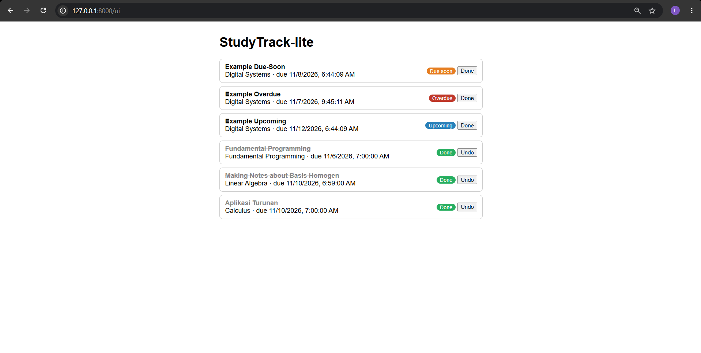
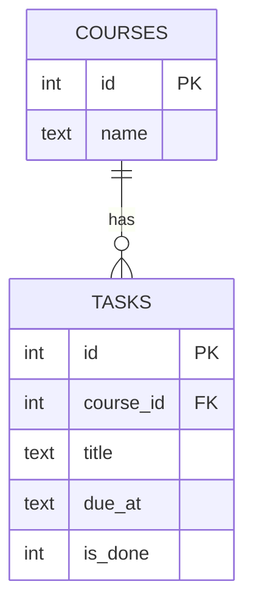

# StudyTrack-lite

A small task manager for university assignments. It flags tasks due in under 24 hours and shows overdue ones, so deadlines don't get forgotten.



## Features
- Add courses and tasks with optional deadlines
- Automatic status per task: due soon, overdue, upcoming, no deadline, done
- Urgent tasks sorted to the top
- Mark tasks done or undo, edit, and delete
- Simple web page plus interactive API docs

## Tech stack
Python, FastAPI, SQLite, pytest, plain HTML and JavaScript

## How to run
```bash
git clone https://github.com/luthfirhmn123/studytrack-lite.git
cd studytrack-lite
python -m venv venv
.\venv\Scripts\Activate.ps1
pip install -r requirements.txt
uvicorn main:app --reload
```
Open http://127.0.0.1:8000/ui for the page and http://127.0.0.1:8000/docs for the API docs.

Run the tests with `python -m pytest -v`.

## API endpoints
| Method | Path | Description |
|---|---|---|
| POST | /courses | Create a course |
| GET | /courses | List courses |
| POST | /tasks | Create a task |
| GET | /tasks | List tasks with status, urgent first |
| PATCH | /tasks/{id} | Update a task |
| DELETE | /tasks/{id} | Delete a task |
| GET | /ui | Web page |

## Database


## Status rules and assumptions
- A completed task is always "done", even if its deadline has passed.
- Less than 24 hours left is "due soon". Exactly 24 hours is "upcoming".
- A deadline in the past is "overdue". No deadline is "no deadline".
- Deadlines are stored in UTC. A time without a timezone is treated as UTC.
- Sort order: due soon, overdue, upcoming, no deadline, done. The earliest deadline comes first within each group.

## Limitations
- No login, and the page can only list tasks and mark them done. Other actions go through /docs.
- A deadline can't be cleared once it's set.
- SQLite is used for simplicity.